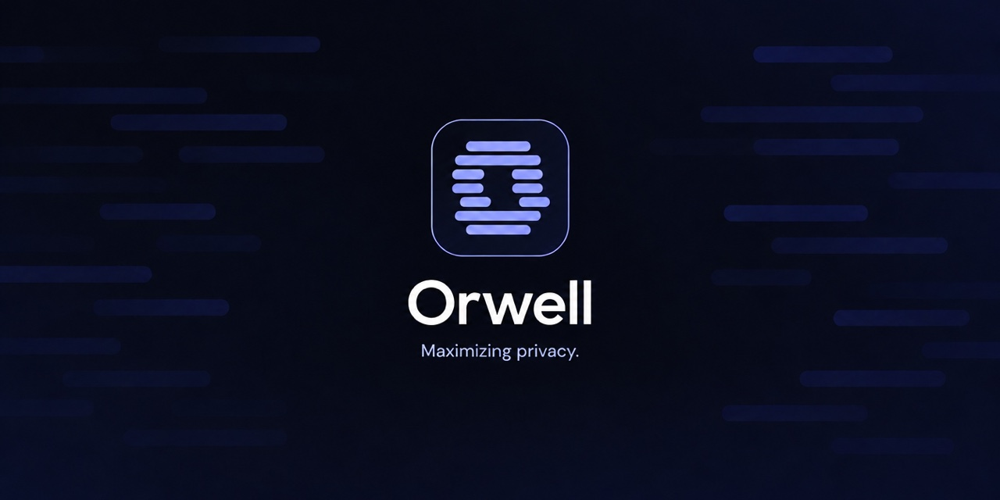
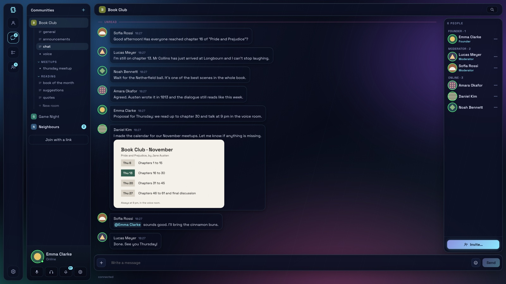
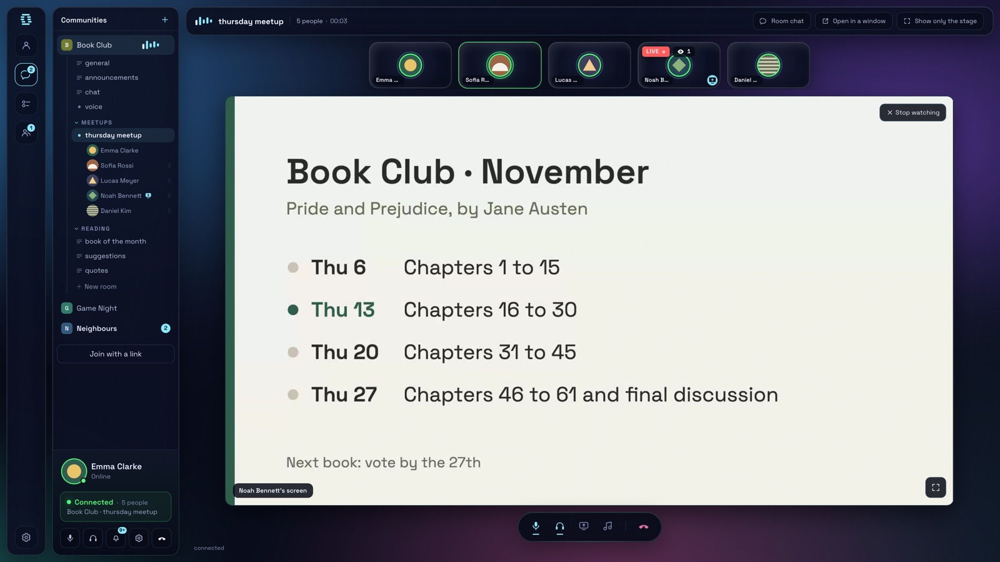
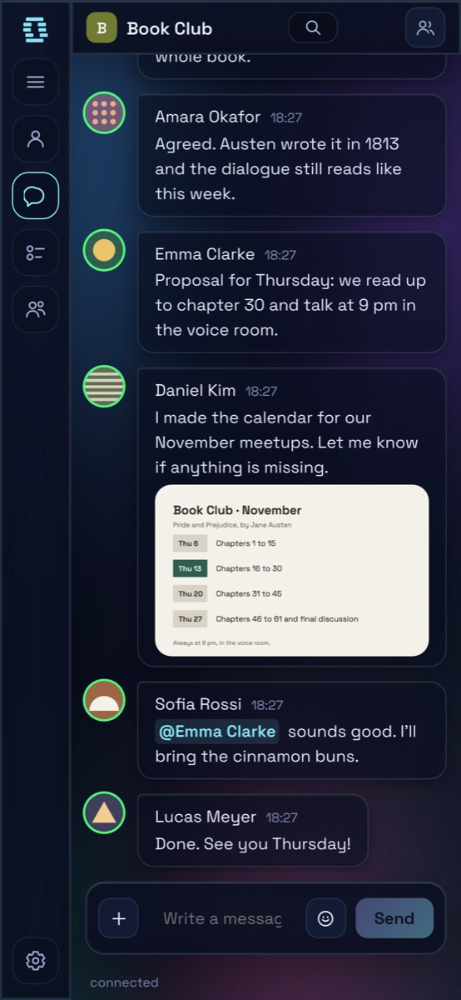
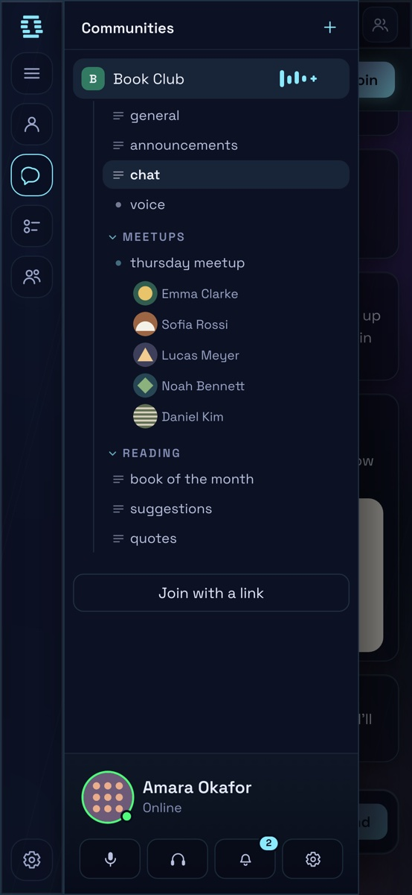
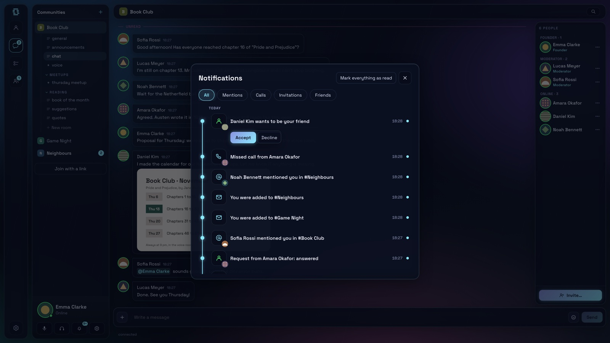

<p align="center">
  
</p>

Orwell is a place for communities to talk: text rooms, voice and video calls,
direct messages and a wall for each account. Everything is end-to-end
encrypted, so the server that carries your messages cannot read them. It runs
at [orwell.pt](https://orwell.pt), in the browser and as a desktop app for
Windows and macOS, with a Linux version on the way. The current version is 1.3.3 "Carmelo". I build it on my
own, and I have put hundreds of hours into it so far.

<p align="center">
  <a href="https://ko-fi.com/orwell_eu"></a>
  &nbsp;
  <a href="https://github.com/magnuslab-sudo/orwell"></a>
</p>

<p align="center">
  <br>
  <sub><i>A community in the desktop app: rooms on the left, the conversation in the middle.</i></sub>
</p>

## Why I made it

I am the solo developer of Orwell, and I make it in Portugal.

Discord is a good product. People run communities on it, play together and
talk for hours. But one company can read all of it: what you write, who you
talk to, when, and for how long.

I wanted the same kind of place without that part. So there is one rule in all
of the code: if the server does not need a piece of data to deliver a message,
that data does not travel in the clear. Names, avatars, room names, reactions,
replies, mentions and file names all stay inside the encryption.

If you like where this is going, you can support Orwell and my work by
[buying me a coffee](https://ko-fi.com/orwell_eu). Encryption runs on maths.
I run on coffee.

## What works today

- **Communities** with text and voice rooms, categories, roles, pinned
  messages and ticket rooms.
- **Direct messages and replies.**
- **Voice, video and screen sharing.** Every frame is encrypted on your device
  before it leaves. The media relay on the server has no key.
- **A wall for each account.** Posts in order of arrival. No ranking, no
  like counter.
- **Several devices on one account.** You pair a new device with a code, and
  both screens show the same six words.
- **No email and no phone number.** Your account is a key pair.
- **Reports.** A member can report a message or a person. A person, not a
  script, decides on suspensions.
- **In Portuguese**, in the app and on the site.
- **Your own server.** The homeserver is in this repository.

<p align="center">
  <br>
  <sub><i>A voice call with screen sharing. Sound and picture are encrypted on each device.</i></sub>
</p>

<table align="center">
  <tr>
    <td align="center" width="50%">
      <br>
      <sub><i>The conversation on a phone.</i></sub>
    </td>
    <td align="center" width="50%">
      <br>
      <sub><i>The rooms of a community, with five people in the voice room.</i></sub>
    </td>
  </tr>
</table>

<p align="center">
  <br>
  <sub><i>Notifications: a friend request, a missed call and mentions.</i></sub>
</p>

## The Enclave protocol

Orwell speaks its own protocol, **Enclave**. I built it on open standards,
with one goal: the server should move messages around and learn as little as
possible while doing it. Orwell is the app. Enclave is the language it talks.

- **MLS (RFC 9420)** for every channel, room and direct message, through
  [`ts-mls`](https://github.com/LukaJCB/ts-mls). Large groups stay practical,
  with forward secrecy and post-compromise security.
- **Post-quantum by default.** The cipher suite is
  `MLS_256_XWING_CHACHA20POLY1305_SHA512_Ed25519`. X-Wing combines X25519 with
  ML-KEM-768, so an attacker has to break both.
- **Your identity is a key pair.** Your address is a hash of your signing key.
  Anyone can check it. No certificate authority, no email, no phone number.
- **Opaque channel addresses.** Every channel looks the same to the server: 40
  random characters. Whether it is a direct message, a wall or a room, and what
  it is called, lives only on the members' devices.
- **Signed authorship.** Each message carries its author's device signature,
  inside the encryption. A message can be forwarded or reported without anyone
  being able to put words in someone else's mouth.
- **Padding and coarse time.** Messages are padded to at least 512 bytes, and
  timestamps are kept to the minute. Exact sizes and times help traffic
  analysis, and the app does not need them.
- **Encrypted calls.** Sound, video and screen sharing use SFrame, keyed from
  the channel's MLS group. The media relay forwards frames it cannot open.
  (Same shape as RFC 9605, not wire-compatible.)
- **Federation without names.** Servers sign the envelopes they pass to each
  other, never the user. The receiving server knows which server vouched for a
  message, not which person sent it.

## What the server sees

I would rather tell you the limits than have you find them.

**The server cannot read:** message text, names, avatars, room names,
reactions, replies, mentions, typing activity, file names, file contents, or
call audio and video. It keeps encrypted messages for people who are offline,
but it has no key to open them. It never gets your password either: the
password only unlocks your account on your own device.

**The server does see:**

- The IP address of whoever connects. The Orwell server itself keeps no
  access log by default. On orwell.pt, the web server in front of it keeps a
  short log for 14 days, with the end of each IP address removed.
- When you are connected, and which channels you are in. Channel addresses are
  opaque, so the database does not say who talks to whom. But someone watching
  the running server can see which account writes in which channel, and when.
- The size of what you send (anything under 512 bytes looks the same), and
  the minute it arrived.
- In a call, who is in the call with whom. Sound and picture stay encrypted.
- How many devices an account has.

**One exception.** When someone reports a message, their device decrypts it and
gives it to the server. That is the only way the server ever reads a message:
somebody hands it over. The [privacy page](https://orwell.pt/privacy.html) says
what is kept and for how long.

**What encryption cannot do.** Anyone in a channel can take a screenshot.
Malware running on your device while the account is open can read your
messages. The browser version keeps your identity key in the page, because
there is nowhere else to put it. For an account you care about, use the desktop
app.

The full list is in [`docs/THREAT-MODEL.md`](docs/THREAT-MODEL.md). It lists
the weaknesses, not only the strengths. Read it before you trust Orwell with
anything that matters.

## Try it

- **In the browser:** [orwell.pt/app](https://orwell.pt/app/). Pick a name and
  a password. No email.
- **On the desktop:** installers for Windows and macOS at
  [orwell.pt/transferencias](https://orwell.pt/transferencias/), each with its
  SHA-256 sum.
- **On Linux:** I am working on it. Until then, the browser version works.
- **On a phone:** open orwell.pt/app and add it to your home screen. To use the
  same account, pair the phone from the computer in Settings, "Devices", "Add
  device".

The installers are not signed by Apple or Microsoft yet, so your system will
warn you the first time. On Windows the app updates itself, and only accepts an
update signed with Orwell's own Ed25519 key. On macOS it tells you when a new
version is out.

## Run it yourself

Orwell is free software under the AGPL-3.0. You can run your own server for
your community, change the code and share it. If you change it and let other
people use your version, publish your changes under the AGPL too. If that does
not work for you, there is a commercial licence. If you would rather not run a
server at all, I can host one for you. Both are in
[`COMMERCIAL.md`](COMMERCIAL.md).

You need Node.js 22 or later.

```bash
npm install
npm run build

npm run server      # homeserver on :8448
npm run dev:web     # browser app on http://127.0.0.1:5173
npm run dev:client  # desktop app
npm run e2e         # two real clients through the local server
```

The last three can run at the same time. Two clients on one server is the
quickest way to watch a message cross.

### On a real server

`infra/` has a Docker Compose setup: the homeserver, Caddy for TLS, and notes
for running behind an existing nginx. [`infra/README.md`](infra/README.md) walks
through it.

```bash
cd infra
cp .env.example .env    # set ENCLAVE_DOMAIN first
docker compose up -d --build
```

Choose the domain carefully. Every account address includes it, and changing it
later means everyone creates a new account.

The settings that matter most:

| Variable | Default | What it does |
|---|---|---|
| `ENCLAVE_SERVER_NAME` | `localhost:8448` | The server's public name. Needs a real domain to federate |
| `ENCLAVE_RETENTION_DAYS` | `30` | Days the server keeps encrypted messages for people who are offline. `0` keeps nothing past live delivery. Your strongest privacy setting |
| `ENCLAVE_FEDERATION_ALLOWLIST` | empty | Peer servers you trust, comma-separated. **Empty means federation is off** |
| `ENCLAVE_LOG` | off | `debug` turns on request logging. An access log records what each user does, so leave it off in production |
| `ENCLAVE_SFU_PORT` | empty | One port, UDP and TCP, for call media. Empty means no relay, and calls connect people directly |
| `ENCLAVE_SFU_ANNOUNCED_IP` | empty | The public address the relay announces. Required inside Docker, or calls never connect |

`infra/.env.example` explains the rest.

## How the code is laid out

```
packages/protocol      wire types, addressing, identity, signed federation envelopes
packages/crypto        MLS, SFrame, attachment encryption
packages/client-core   session, vault and calls, with no platform imports
packages/ui            the React app, shared by the browser and the desktop
apps/server            gateway, federation, blind storage (SQLite) and the SFU
apps/client            Electron host: keys in the main process, UI in a sandbox
apps/web               browser host
apps/site              orwell.pt
scripts/               end-to-end tests with real clients, measurements, tools
```

Every screen has one implementation. The same session and call code runs in a
browser tab and in Electron.

The packages are named after the protocol, so you will see `@enclave/*` and
`ENCLAVE_*` throughout the code.

Code comments and the documentation are in English. Many identifiers are still
in Portuguese. The app and the site are in Portuguese.

## Security

Found something? Write to **orwell.eu@proton.me**, please not in a public
issue. You will hear back within 72 hours. [`SECURITY.md`](SECURITY.md) has the
details.

## Where the project stands

Orwell is in use, and it is young. 1.0 "Arca" came out on 28 October 2026.
The release notes are in [`docs/novidades.json`](docs/novidades.json).

Known limits:

- **Federation is built and unit-tested, but has never run between two live
  servers.** It is off by default.
- **Installers are not signed by Apple or Microsoft**, and macOS has no
  automatic update yet.
- **No reproducible builds yet**, so you cannot check that an installer matches
  this source.
- **No notifications while the phone app is closed.** They would have to go
  through Apple or Google, and I have not made that privacy decision yet.
- **No account recovery, on purpose.** Recovery means the server holds
  something that gives your access back. Keep your password and export your
  account.
- **Never open the same account file on two devices.** It breaks the channel
  encryption for good. Pair the second device instead.
- **No cover traffic.** Someone who watches every link can still guess that two
  people are talking.

If you run a community and want to test Orwell with it, there is an
[ambassador programme](https://orwell.pt/ambassadors.html).

## Contributing

Pull requests are welcome. Read [`CONTRIBUTING.md`](CONTRIBUTING.md) first. I
ask every contributor to agree to the [CLA](CLA.md), once.

## License

Orwell is licensed under the
[GNU Affero General Public License, version 3 only](LICENSE)
(AGPL-3.0-only). Copyright © 2026 Duarte Bivar.

A commercial licence is available for anyone who cannot follow the AGPL, for
example to run a modified server without publishing the changes. See
[`COMMERCIAL.md`](COMMERCIAL.md).

Third-party components keep their own licences, listed in
[`THIRD-PARTY-NOTICES.txt`](THIRD-PARTY-NOTICES.txt).

## Thanks

- [David Rodrigues](https://github.com/davidrodrigues98), for reviewing the
  code.
- [Blotterrot](https://github.com/Blotterrot), for a security audit that helped me fix
  flaws in 1.2.1.
- [viniciussilva2504](https://github.com/viniciussilva2504), for the help.

## Support Orwell

Orwell has no ads and no investors. I build it on my own, from Portugal, and a
few collaborators look over the code. If it is useful to you, you can support
the server and the work on [Ko-fi](https://ko-fi.com/orwell_eu).

And if you have a GitHub account, a star on this repository costs nothing and
helps other people find Orwell. Thank you.

## Contact

**orwell.eu@proton.me**, in Portuguese or in English.
