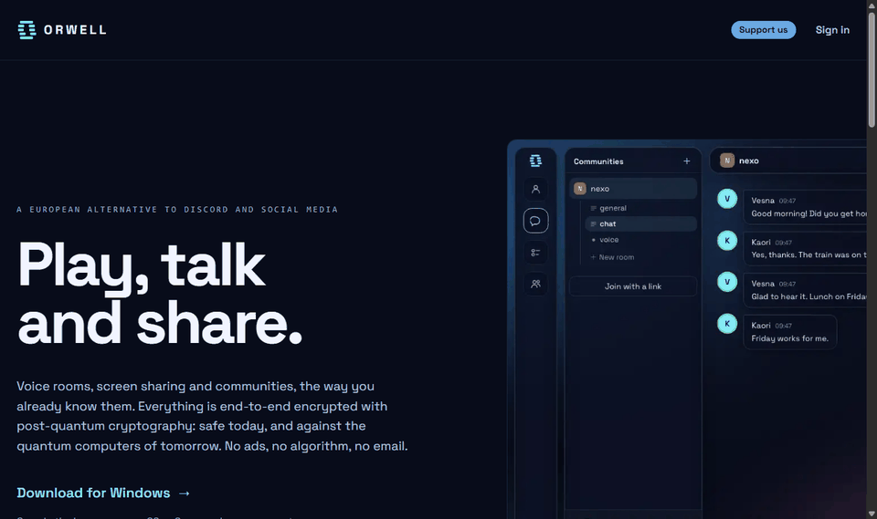
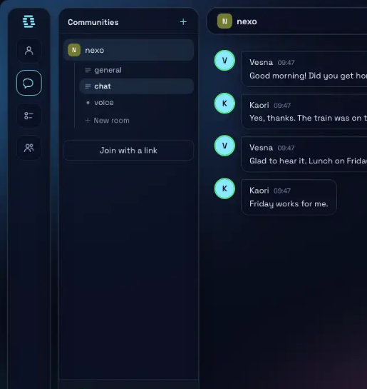
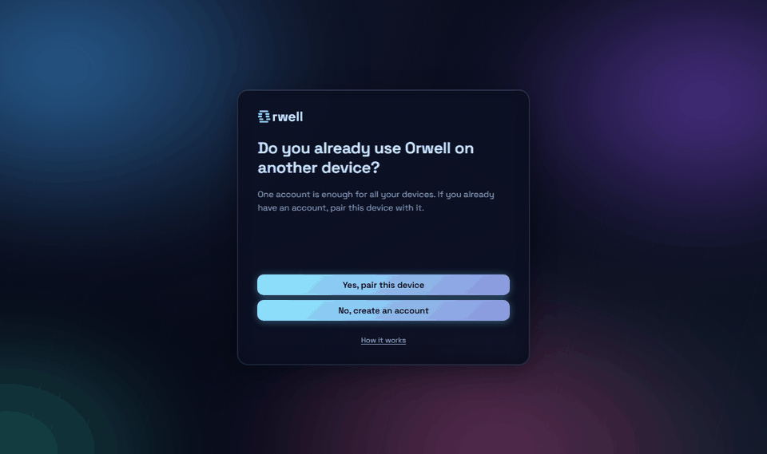
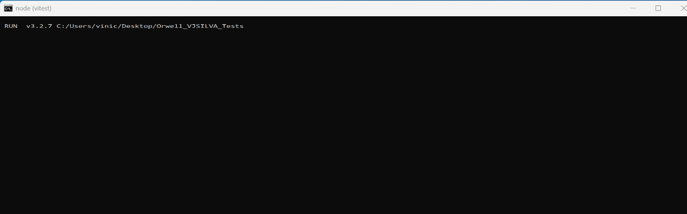

# Orwell — suíte de QA

Suíte de verificação sobre o Orwell público em [orwell.pt](https://orwell.pt). Há duas levas, com oráculos diferentes.

A leva 1 olha para o que uma pessoa vê e para o HTTP público: site, portão da conta, rotas sem sessão. São 15 casos Selenium (cinco por tema), cinco pedidos Postman e um roteiro de telemóvel. Nenhum caso cria conta, assina um pedido, abre o cofre ou lê a base de dados. O portão pára antes de "Create account". Se a frase "Creating your account" aparecer, o caso falha.

A leva 2 olha para o que o ecrã não mostra. Cada teste Vitest sobe o homeserver verdadeiro e lê disco, ciphertext, linha de SQLite ou o cofre com o Argon2id de produção.

| Tema | Onde | Casos | Oráculo |
| --- | --- | --- | --- |
| Site | `testes/test_site.py` | 5 | Texto visível, `lang`, URL, ausência de alerta |
| Nome | `testes/test_nome.py` | 5 | O passo seguinte, o botão, a inicial da fotografia |
| Palavra-passe | `testes/test_palavra_passe.py` | 5 | O passo, o erro, o `type` do campo |
| API | `postman/Orwell_API.postman_collection.json` | 5 | Código HTTP e o corpo, sem ecoar o script |
| Telemóvel | `manual/appium-telemovel.md` | O mesmo portão | À mão, sem código Appium |
| Integração | `integration/*.integracao.test.ts` | 8, em 6 ficheiros | Homeserver verdadeiro |

Os GIFs desta página são de seis casos de layout, gravados em headless a 1280×900 contra orwell.pt em 17 de novembro de 2026. Os seis passaram, em 3 min 56 s. Numa página mais alta que a janela, o gravador desce e volta ao topo **depois** das verificações. Esse movimento mostra o layout. Não é uma asserção.

## Site

O site é a superfície pública. Os casos perguntam se a homepage, a língua e a privacidade são as páginas certas, e se um caminho estranho não se transforma na homepage nem executa marcação.

### Herói e entrada

`test_homepage_mostra_heroi_e_entrada` abre `/`. O título visível contém "Play, talk". O `<title>` contém "A European alternative to Discord". O link "Sign in" aponta para `/app/`.





### Língua

`test_link_pt_abre_a_homepage_em_portugues` segue `a[hreflang='pt']`. O título passa a "Joga, fala", o documento fica `lang="pt-PT"` e o URL acaba em `/pt`.


### Privacidade

`test_privacidade_abre_pelo_rodape` usa o link do rodapé, não um URL escrito à mão. O título visível fica "Privacy" e o URL acaba em `/privacy.html`.


Os outros dois casos do ficheiro não têm GIF: o ecrã quase não muda, e o oráculo é a ausência de um efeito.

| Caso | O que confirma |
| --- | --- |
| `test_caminho_desconhecido_nao_e_a_homepage` | `/esta-pagina-nao-existe-qa` não traz o herói nem o título da homepage. A resposta observada foi 404 com corpo vazio. |
| `test_marcacao_no_endereco_nao_e_executada` | `/?q=<script>alert(1)</script>` mantém o herói, não abre alerta e não injecta ``. |

## Nome

O portão pergunta o nome antes da fotografia. A app segue a língua do browser. Os testes fixam `?lingua=en` e comparam o catálogo inglês. "Ana Silva" é dados de teste. A conta não chega a existir.

### Letras até à fotografia

`test_nome_com_letras_avanca_para_a_fotografia` escolhe "No, create an account", escreve "Ana Silva" e avança. "Continue" está activo. O passo seguinte é a fotografia e a inicial visível é "A".


| Caso | O que confirma |
| --- | --- |
| `test_nome_vazio_ou_so_espacos_nao_avanca` | Sem texto, ou só com espaços, "Continue" fica inactivo e a pergunta não muda. |
| `test_digitos_no_campo_de_nome_sao_aceites` | "123456" avança. A inicial é "1". |
| `test_acentos_emoji_e_marcacao_nao_sao_executados` | "Ção 🧪 ``" avança como texto. Não há alerta nem ``. A inicial é "Ç". |
| `test_nome_mais_longo_que_o_perfil_ainda_avanca` | O campo não tem `maxLength`. Quarenta letras avançam. |

Lacuna de produto, não falha da suíte: o editor de perfil corta o nome a 32 (`NAME_MAX` em `packages/ui/src/screens/profile/ProfileEditor.tsx`). O portão, nesta leva, não corta. O caso longo está verde porque descreve o comportamento actual. Quem fechar a lacuna tem de mudar o oráculo: passar a esperar que o campo recuse ou corte acima de 32.

## Palavra-passe

Nenhum caso chega a "Create account". A frase "Creating your account" falha o teste.

### Menos de oito caracteres

`test_menos_de_oito_caracteres_fica_no_passo` escreve `abcdefg` e avança. A pergunta continua a ser "What is the password going to be?" e o erro é "Type at least 8 characters."


### Mostrar e ocultar

`test_mostrar_revela_e_voltar_a_ocultar` escreve `Valido!1`. O campo nasce `type="password"`. "Show" passa-o a `type="text"` com o mesmo valor. "Hide" devolve `type="password"`.



| Caso | O que confirma |
| --- | --- |
| `test_oito_caracteres_com_simbolo_avancam_para_a_confirmacao` | `Valido!1` (8, com símbolo) chega a "Confirm the password". A conta não é criada. |
| `test_so_digitos_com_oito_caracteres_passam_a_regra` | `12345678` também chega à confirmação. O botão passa a "Create account". Não há regra de maiúscula, dígito ou símbolo: o comprimento chega. |
| `test_confirmacao_diferente_nao_cria_a_conta` | `Valido!1` seguido de `Valido!2` mostra "The two passwords are different." e fica na confirmação. |

O clip antigo do portão, do outro aparelho até à palavra-passe e sem o erro, continua em `docs/media/portao-nome.gif`. Os dois GIFs desta secção substituem-no como evidência: um pára no erro, o outro mostra o revelar.

## O que orwell.pt fez nesta leva

Isto é comportamento observado, com a suíte verde em cima dele.

- Nome vazio ou só espaços não avança.
- Dígitos, acentos e emoji no nome avançam. A marcação fica texto.
- Quarenta letras avançam no portão. O perfil corta a 32.
- A palavra-passe pede 8 caracteres e mais nada. `12345678` chega à confirmação.
- `GET /_enclave/health` responde `{"ok":true,"server":"orwell.pt"}`.
- `POST /_enclave/federation/v1/send` com número e script responde 400 `malformed-envelope` e não ecoa o script.
- `POST /_enclave/relato` com versão e texto numéricos responde 400 `malformed-report`.
- `POST /_enclave/denuncia` com `{}` responde 401 `unauthorized`.

## Achados

De toda a suíte, dois casos passam e deixam um problema à vista. Não há dez: não há falha de execução, e os outros negativos passam porque o controlo segura. O relatório, os GIFs e o comando estão em [`negativos/README.md`](negativos/README.md).

## Fora da leva 1

- Criar a conta até ao fim, emparelhar, entrar numa comunidade, enviar mensagem, convite, chamada com média.
- O corpo cifrado do WebSocket.
- `POST /_enclave/health` (a rota só existe em GET) e "Advanced options" com um servidor inválido.
- Appium automatizado.

A denúncia assinada, a federação entre dois homeservers, o porto do SFU, o cofre e a pré-visualização estão na leva 2.

## Leva 2 — integração

Vitest, sem browser. Cada caso sobe o homeserver (`levantarServidor`). O cofre usa o Argon2id de produção. A config está em `integration/vitest.config.ts` e não carrega o KDF rápido dos testes unitários. Corre à parte de `npm test` e de `pytest`.



| Tema | Onde | O que a corrida mostra |
| --- | --- | --- |
| Pré-visualização | `integration/ligacao.integracao.test.ts` | A página em 127.0.0.1 recebe zero ligações. O motivo é o mesmo em todos os endereços bloqueados. |
| Federação | `integration/federacao.integracao.test.ts` | O ciphertext sai de um homeserver, o outro lê a chave por HTTP e fica com o par. Quem está fora da allowlist leva 403 e não fica inscrito. |
| SFU | `integration/sfu.integracao.test.ts` | Com o motor de pé, o `hello.ok` anuncia `sfu`. Com o porto tomado, o texto continua e o `hello` não traz `sfu`. |
| Denúncia | `integration/denuncia.integracao.test.ts` | O mesmo pedido leva 401 antes do login e 200 depois. O segundo envio não grava outro ficheiro. |
| Apoio | `integration/apoio.integracao.test.ts` | A vigia lê a fixture por HTTP e serve `/_enclave/apoiar.json`. Com a campanha em baixo, `/_enclave/health` continua ok. |
| Cofre | `integration/cofre.integracao.test.ts` | A frase certa reabre a mesma conta. A frase errada deixa o cofre fechado. |

Oito testes, seis ficheiros. Na gravação, o cofre leva a maior parte do meio minuto. As duas linhas de registo na imagem são o caso a funcionar: a campanha que não se leu, e o porto de média que já estava tomado.

O produto fala `https://` na federação. O teste reescreve essa chamada para o outro homeserver nesta máquina, e só dentro do teste. A pré-visualização continua a recusar loopback.

A partir da raiz do repositório, com Node 22 ou mais recente e os pacotes compilados (`npx tsc -b`):

```powershell
node .\node_modules\vitest\vitest.mjs run --config qa/integration/vitest.config.ts
```

## Correr o Selenium

Python 3.10+, Google Chrome. O Selenium Manager trata do ChromeDriver. A partir de `qa/`:

```powershell
py -m venv .venv
.venv\Scripts\Activate.ps1
python -m pip install -r requirements.txt
Copy-Item .env.example .env
python -m pytest
```

`ORWELL_HEADED=1` no `.env` abre o Chrome à vista. Sem isso corre em headless. `ORWELL_SITE_URL` e `ORWELL_APP_URL` apontam o alvo. Por omissão é orwell.pt.

Um ficheiro: `python -m pytest testes/test_nome.py`. Um caso: `python -m pytest testes/test_nome.py::test_nome_com_letras_avanca_para_a_fotografia`.

Cada caso guarda o ecrã final em `artefactos/ecras/`. Com `ORWELL_GIF=1`, o percurso vai para `artefactos/<nome-do-teste>.gif`. As duas pastas ficam de fora do Git.

```powershell
$env:ORWELL_GIF = "1"
python -m pytest testes/test_site.py::test_homepage_mostra_heroi_e_entrada
```

Os seis GIFs publicados nesta página estão em `docs/media/`. Para os substituir depois de uma corrida nova, copia os ficheiros de `artefactos/` para `docs/media/`.

O clip curto do portão, sem criar conta, regenera-se à parte:

```powershell
python scripts/gravar_gif.py
```

O resultado é `docs/media/portao-nome.gif`.

## Correr o Postman

Importa a coleção e um ambiente (`Orwell — orwell.pt` ou `Orwell — local`). O local precisa de `npm run server` e usa `localhost:8448`.

Pelo Newman, a partir de `qa/`:

```powershell
npx --yes newman run postman/Orwell_API.postman_collection.json -e postman/Orwell_orwell.pt.postman_environment.json
```

## Mapa

```text
conftest.py            Chrome novo por teste e ecrã final
gravador.py            percurso em GIF quando ORWELL_GIF=1
dados.py               URLs e frases do catálogo inglês
evidencias.py          ecrã, recorte e pastas
paginas/site.py        page object do site
paginas/portao.py      page object do portão
testes/                cinco casos por ficheiro, leva 1
negativos/             os dois achados, com GIF; fora do pytest por omissão
integration/           Vitest, homeserver verdadeiro, leva 2
postman/               coleção e dois ambientes
manual/                roteiro Appium, sem automação
scripts/gravar_gif.py  GIF curto do portão
docs/media/            GIFs e recortes publicados
artefactos/            ecrãs e GIFs da última corrida, fora do Git
```
