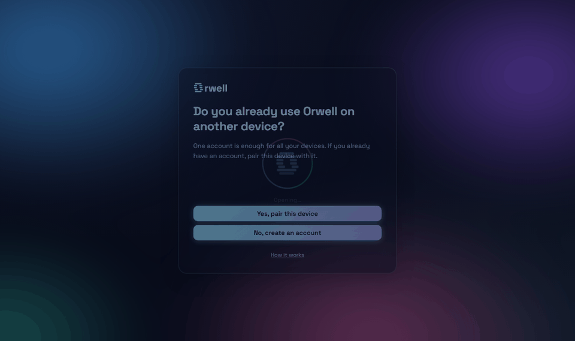
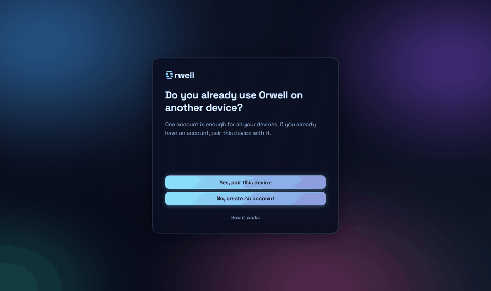

# Achados

Classificação de toda a suíte de QA: 15 casos Selenium, 5 pedidos Postman, 8 testes Vitest. A pergunta era quais mostram vulnerabilidade, bug ou problema de execução.

Não há dez. Não inventei casos para encher a pasta.

| Classe | Quantos | O que significa |
| --- | --- | --- |
| Problema de execução | 0 | Nenhum caso está vermelho. O Selenium passou contra orwell.pt. A integração passou em local. |
| Vulnerabilidade explorável | 0 | Os casos hostis passam porque o efeito mau não acontece. |
| Bug | 1 | O portão aceita um nome que o perfil corta. |
| Fraqueza de política | 1 | A palavra-passe só exige comprimento. |

Os dois achados estão nesta pasta. O teste de origem continua em `testes/`, para a leva de cinco por tema não perder o caso. `python -m pytest` sem caminho não entra aqui.

Corrida desta pasta, em 17 de novembro de 2026, headless, contra orwell.pt: 2 passaram, em 41 s. Nenhuma conta foi criada.

## Bug — o nome não tem tecto no portão

`test_nome_mais_longo_que_o_perfil_ainda_avanca`

O editor de perfil corta o nome a 32 (`NAME_MAX`). O campo do portão não tem `maxLength`. Quarenta letras entram, "Continue" acende e o passo da fotografia abre. O caso fica verde porque descreve o produto como está. Quem fechar a lacuna muda o oráculo: o campo passa a recusar ou a cortar acima de 32.



## Política — oito dígitos chegam

`test_so_digitos_com_oito_caracteres_passam_a_regra`

`12345678` não tem letra nem símbolo e chega a "Confirm the password". O botão já diz "Create account". A suíte pára aí. Não há regra de maiúscula, dígito ou símbolo: o comprimento de 8 basta. É fraqueza de política, não uma quebra da conta.



## O que foi revisto e não é achado

Estes casos são negativos e passam. O resultado é o controlo a segurar. Não entram nesta pasta.

| Caso | Resultado |
| --- | --- |
| Script no URL da homepage | Não há alerta nem marcação injectada. |
| Marcação no campo do nome | Fica texto. Não há alerta. |
| Nome vazio ou só espaços | "Continue" fica inactivo. |
| Menos de 8 caracteres na palavra-passe | O passo não muda. O erro aparece. |
| Confirmação diferente | A conta não é criada. |
| Caminho que o site não tem | Não é a homepage. A resposta observada foi 404. |
| Federação com tipos errados | 400 `malformed-envelope`, sem ecoar o script. |
| Registo com tipos errados | 400 `malformed-report`. |
| Denúncia sem assinatura | 401 `unauthorized`. O ficheiro não é gravado. |
| Pré-visualização de 127.0.0.1 | Zero ligações. O motivo não revela o endereço. |
| Federação fora da allowlist | 403. O par não fica inscrito. |
| Frase errada no cofre | O cofre fica fechado. |
| Porto do SFU tomado | O texto segue. O `hello` não anuncia `sfu`. |
| Campanha de apoio em baixo | `/_enclave/health` continua ok. |

Dígitos, acentos e emoji no nome também avançam. Isso está coberto em `testes/test_nome.py` e não está classificado como bug: o campo aceita o que a pessoa quer mostrar.

## Correr outra vez

A partir de `qa/`:

```powershell
$env:ORWELL_GIF = "1"
python -m pytest negativos
```

O gravador escreve o GIF em `artefactos/`. Os dois ficheiros desta pasta são a cópia publicada. Para os actualizar, copia de `artefactos/` para `negativos/` depois da corrida.
